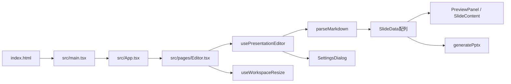

# 開発者向けガイド — markdown-to-pptx

> 対象リポジトリ: `wvyrbnyq3t/markdown-to-pptx`  
> 対象ブランチ: `main`  
> 確認日: 2026-07-16  
> 推奨配置先: リポジトリ直下の `DEVELOPER_README.md`

この文書は、「どのファイルがどの責務を持ち、どの関数が何を行い、どこから利用されるか」を一意に確認できるようにするための開発者向けリファレンスです。

## 1. 文書の読み方と対象範囲

この文書では、次の単位でコードを整理します。

- **責務**: そのファイルが担当する処理
- **公開API**: `export`され、他ファイルから使用される関数・型・定数
- **内部関数**: ファイル内部だけで使用される名前付き関数
- **主な利用元**: その公開APIをimportしているファイル
- **変更時の影響**: 仕様変更時に同時確認すべきファイル

対象とする「関数」は、モジュール直下で宣言された名前付き関数、exportされたReactコンポーネント、カスタムフックです。JSX内に直接書かれた短い無名コールバックは、各コンポーネントのイベント責務としてまとめて説明します。

---

## 2. アプリケーション全体像

このアプリは、Markdown文字列を中間データである`SlideData[]`へ変換し、その同じデータをブラウザプレビューとPPTX出力の両方で使用します。



### 主要な実行経路

1. `index.html`が`/src/main.tsx`を読み込む。
2. `src/main.tsx`がReactルートへ`App`を描画する。
3. `src/App.tsx`が`HashRouter`でエディター画面とガイド画面を切り替える。
4. `src/pages/Editor.tsx`が画面全体を構成する。
5. `usePresentationEditor()`がMarkdown、設定、ファイル名、出力状態を管理する。
6. `parseMarkdown()`がMarkdownを`SlideData[]`へ変換する。
7. `PreviewPanel`と`SlideContent`が`SlideData[]`を画面へ描画する。
8. `generatePptx()`が同じ`SlideData[]`をPowerPointへ変換する。

### データの単一ソース

| データ | 所有者 | 利用先 |
|---|---|---|
| Markdown文字列 | `usePresentationEditor` | `parseMarkdown`、`MarkdownEditorPanel` |
| スライドデータ | `parseMarkdown`の戻り値 | `PreviewPanel`、`PresentationMode`、`generatePptx` |
| スライド設定 | `usePresentationEditor` | プレビュー、設定ダイアログ、PPTX出力 |
| ワークスペース幅 | `useWorkspaceResize` | `Editor.tsx`、`WorkspaceResizer` |
| カーソルが属するスライド番号 | `Editor.tsx` | `MarkdownEditorPanel`から受信し`PreviewPanel`へ渡す |

---

## 3. 開発環境

### 必要なコマンド

```bash
npm install
npm run dev
npm run lint
npm run build
npm run preview
```

### `package.json`のスクリプト

| コマンド | 実行内容 |
|---|---|
| `npm run dev` | Vite開発サーバーを起動 |
| `npm run build` | `tsc -b`で型検査後、Viteで本番ビルド |
| `npm run lint` | ESLintでリポジトリ全体を検査 |
| `npm run preview` | `dist`のビルド結果をローカル確認 |

### 主要ライブラリ

| ライブラリ | 用途 |
|---|---|
| React / React DOM | UI構築 |
| React Router DOM | `HashRouter`による画面遷移 |
| unified / remark-parse | Markdown AST生成 |
| remark-gfm | 表などGFM記法 |
| remark-math | インライン・ブロック数式 |
| KaTeX | ブラウザプレビューの数式表示 |
| MathJax | PPTX用数式SVG生成 |
| PptxGenJS | `.pptx`生成 |
| Firebase | Firebase初期化用。現状の主要エディター処理からは独立 |
| UUID | スライドID生成 |
| Tailwind CSS | 依存関係には存在するが、主要画面は通常CSS中心 |

---

## 4. ディレクトリ構成

```text
markdown-to-pptx/
├── .github/
│   └── workflows/
│       └── deploy.yml
├── public/
│   ├── favicon.svg
│   └── icons.svg
├── src/
│   ├── assets/
│   │   └── favicon/
│   │       └── favicon.png
│   ├── components/
│   │   ├── markdown-insert/
│   │   │   ├── MarkdownElementSheet.tsx
│   │   │   └── markdownElementDefinitions.ts
│   │   ├── settings/
│   │   │   ├── SettingControls.tsx
│   │   │   └── SettingsDialog.tsx
│   │   ├── slide/
│   │   │   ├── InlineContentRenderer.tsx
│   │   │   ├── MarkdownListView.tsx
│   │   │   └── SlideContent.tsx
│   │   ├── ui/
│   │   │   └── Icons.tsx
│   │   ├── Avatar.tsx
│   │   ├── EditorHeader.tsx
│   │   ├── HeaderMenuDialog.tsx
│   │   ├── Icon.tsx
│   │   ├── MarkdownEditorPanel.tsx
│   │   ├── MobileViewTabs.tsx
│   │   ├── PresentationMode.tsx
│   │   ├── PreviewPanel.tsx
│   │   └── WorkspaceResizer.tsx
│   ├── constants/
│   │   └── initialMarkdown.ts
│   ├── css/
│   │   ├── PresentationMode.css
│   │   ├── app.css
│   │   ├── guide.css
│   │   ├── index.css
│   │   ├── insertMarkdown.css
│   │   ├── reset.css
│   │   ├── responsive.css
│   │   ├── settings.css
│   │   ├── slides.css
│   │   ├── style.css
│   │   ├── tokens.css
│   │   └── utilities.css
│   ├── features/
│   │   ├── markdown/
│   │   │   └── parseMarkdown.ts
│   │   ├── math/
│   │   │   └── renderMath.ts
│   │   └── pptx/
│   │       └── generatePptx.ts
│   ├── hooks/
│   │   ├── usePresentationEditor.ts
│   │   └── useWorkspaceResize.ts
│   ├── pages/
│   │   ├── Editor.tsx
│   │   └── Guide.tsx
│   ├── types/
│   │   ├── presentation.ts
│   │   └── slide.ts
│   ├── utils/
│   │   ├── insertMarkdown.ts
│   │   ├── markdownSlidePosition.ts
│   │   ├── presentationApp.ts
│   │   ├── presentationStorage.ts
│   │   ├── slideGrid.ts
│   │   ├── slideSpacing.ts
│   │   └── slideUnits.ts
│   ├── App.tsx
│   ├── firebase.ts
│   └── main.tsx
├── index.html
├── main.tsx
├── package.json
├── vite.config.ts
├── eslint.config.js
├── tsconfig.app.json
├── tsconfig.json
└── tsconfig.node.json
```

> `index.html`が実際に読み込むエントリーポイントは`/src/main.tsx`です。リポジトリ直下の`main.tsx`は現行の起動経路では使用されません。削除または役割の明記を推奨します。

---

# 5. ルート・設定ファイル

## `index.html`

### 責務

- Reactのマウント先である`#root`を定義する。
- `/src/main.tsx`をViteのエントリーポイントとして読み込む。
- favicon、viewport、ページタイトルを設定する。
- Google Material SymbolsのWebフォントを読み込む。

### 利用関係

```text
ブラウザ
└── index.html
    └── /src/main.tsx
```

### 変更時の影響

- `<script src>`を変更するとアプリの起動ファイルが変わる。
- Material Symbolsを削除すると、フォント名で表示しているアイコンが欠落する可能性がある。

---

## `src/main.tsx`

### 責務

- `document.getElementById("root")`へ`App`を描画する。
- グローバルCSSを読み込む。

### 実行処理

```ts
createRoot(document.getElementById("root")!).render(<App />);
```

### 主な利用元

- `index.html`

### 読み込むCSS

- `reset.css`
- `tokens.css`
- `index.css`
- `style.css`

---

## `main.tsx`（リポジトリ直下）

### 現状

`index.html`から参照されていないため、現行のアプリ起動経路には含まれません。

### 注意点

- `./App.tsx`や`./css/...`を参照しており、現在の`src/`構成と責務が重複している。
- 新規開発者が誤ってこちらを編集しないよう、削除するか`legacy`であることをコメントに明記する。

---

## `src/App.tsx`

### 責務

React Routerのルート定義を行います。

### 公開API

#### `App`

- 種別: デフォルトexportのReactコンポーネント
- 機能:
  - `HashRouter`を生成する。
  - `/`へ`Editor`ページを割り当てる。
  - `/guide`へ`GuidePage`を割り当てる。
- 利用元: `src/main.tsx`

### 変更時の影響

新しいページを追加する場合は、このファイルへ`Route`を追加します。GitHub Pagesで直接URLを扱う都合上、現在は`HashRouter`を使用しています。

---

## `vite.config.ts`

### 責務

- React用Viteプラグインを有効化する。
- GitHub Pages向けの`base`を設定する。

### 現在の設定

```ts
base: "/markdown-to-pptx/#/"
```

### 注意点

`HashRouter`の`#`とViteの`base`に含まれる`#`は役割が異なります。デプロイURLに問題が出た場合は、一般的にはViteの`base`を`"/markdown-to-pptx/"`にし、ルーティングだけを`HashRouter`へ任せる構成を検証してください。

---

## `.github/workflows/deploy.yml`

### 責務

`main`ブランチへのpush、または手動実行時にGitHub Pagesへデプロイします。

### 処理順

1. `actions/checkout`
2. `actions/setup-node`
3. `npm ci`
4. `npm run build`
5. `actions/configure-pages`
6. `dist`をPages artifactとしてアップロード
7. `actions/deploy-pages`

### 変更時の影響

- ビルド出力先を変更した場合は`path: ./dist`も変更する。
- Node.jsバージョンを固定したい場合は`node-version`を変更する。

---

## `package.json`

### 責務

依存パッケージ、npm scripts、ES Modules設定を定義します。

### 注意点

`package-lock.json`と`yarn.lock`が同時に存在します。チーム内でnpmまたはYarnのどちらを正とするか決定し、ロックファイルを1種類へ統一すると再現性が上がります。

---

## `eslint.config.js`

### 責務

TypeScript、React Hooks、React Refreshを含むLint規則を定義します。

---

## `tsconfig.json` / `tsconfig.app.json` / `tsconfig.node.json`

### 責務

- `tsconfig.json`: プロジェクト参照の入口
- `tsconfig.app.json`: ブラウザ側Reactコードの型検査
- `tsconfig.node.json`: Vite設定などNode.js側コードの型検査

---

# 6. ページ

## `src/pages/Editor.tsx`

### 責務

エディター画面のトップレベルコンポーネントです。状態を自分で詳細管理せず、カスタムフックから取得した状態・操作を各子コンポーネントへ配布します。

### 公開API

#### デフォルトexport `Home`

- ファイル名は`Editor.tsx`ですが、関数名は`Home`です。
- 責務を一意にするため、`EditorPage`への改名を推奨します。
- 利用元: `src/App.tsx`

### 内部状態

#### `activeMarkdownSlideIndex`

- Markdownエディター上のカーソルが属するスライド番号。
- `MarkdownEditorPanel`の`onCursorSlideChange`から更新される。
- タイトルスライド有効時は1を加算し、`PreviewPanel.activeSlideIndex`へ渡す。

### 利用する主要モジュール

| モジュール | 役割 |
|---|---|
| `usePresentationEditor` | Markdown、設定、スライド、保存・出力処理 |
| `useWorkspaceResize` | PC版左右パネル幅 |
| `EditorHeader` | 上部操作 |
| `MarkdownEditorPanel` | Markdown入力 |
| `PreviewPanel` | スライドプレビュー |
| `WorkspaceResizer` | 幅変更つまみ |
| `SettingsDialog` | 設定編集 |
| `MobileViewTabs` | モバイル版表示切替 |

---

## `src/pages/Guide.tsx`

### 責務

利用者向けの使い方ページを表示します。

### 公開API

#### `GuidePage`

- 種別: デフォルトexportのReactコンポーネント
- 利用元: `src/App.tsx`
- Markdown記法、グリッド、PPTX出力方法、完成例を表示する。

### 内部関数

#### `CodeExample`

- コード例とコピーボタンを描画する。
- `navigator.clipboard.writeText()`でサンプルをコピーする。
- コピー完了表示を約1.6秒だけ保持する。

#### `scrollToSection(sectionId)`

- 指定IDのセクションへスムーズスクロールする。
- ページ上部のガイドナビゲーションから使用される。

### 内部定数

- `BASIC_SLIDE_EXAMPLE`
- `MULTIPLE_SLIDES_EXAMPLE`
- `GRID_TWO_EXAMPLE`
- `GRID_THREE_EXAMPLE`
- `CODE_BLOCK_EXAMPLE`
- `FULL_EXAMPLE`
- `SYNTAX_ITEMS`

Markdown仕様を追加・変更した場合は、このページとルート`README.md`も同時更新してください。

---

# 7. 状態管理フック

## `src/hooks/usePresentationEditor.ts`

### 責務

エディター画面のドメイン状態と、ファイル入出力を一元管理します。

### 公開型

#### `MobileView`

```ts
"editor" | "preview"
```

モバイル表示でMarkdown入力とプレビューを切り替えるための型です。

#### `UpdateSetting`

`PresentationSettings`のキーと、そのキーに対応する値だけを受け付ける型安全な更新関数です。

### 公開関数

#### `usePresentationEditor()`

### 管理する状態

| 状態 | 意味 |
|---|---|
| `markdown` | 現在編集中のMarkdown |
| `fileName` | `.md`、`.pptx`の基底ファイル名 |
| `settings` | スライド設定 |
| `mobileView` | モバイルの表示対象 |
| `isSettingsOpen` | 設定ダイアログ表示状態 |
| `isExporting` | PPTX生成中か |
| `actionError` | ファイル操作・出力時エラー |

### 派生値

| 値 | 生成方法 |
|---|---|
| `slides` | `parseMarkdown(markdown)` |
| `totalSlideCount` | 通常スライド数 + 任意タイトルスライド |
| `slideStyle` | `createSlideStyle(settings)` |
| `errorMessage` | Markdown解析エラーまたは操作エラー |

### 内部関数

#### `updateSetting(key, value)`

- 設定の特定キーだけを更新する。
- 利用元: `SettingsDialog`

#### `handleMarkdownChange(value)`

- Markdownを更新する。
- 操作エラーをクリアする。
- 利用元: `MarkdownEditorPanel`

#### `handleFileChange(event)`

- `.md`または`.markdown`ファイルを読み込む。
- 内容をMarkdown状態へ設定する。
- ファイル名から拡張子を除いて`fileName`へ設定する。
- 利用元: `EditorHeader`の非表示`input[type=file]`

#### `handleSaveMarkdown()`

- `saveMarkdown(markdown, fileName)`を呼び出す。
- 利用元: `EditorHeader`

#### `handleExport()`

- 出力可能なスライドがあるか確認する。
- 設定とファイル名を正規化する。
- `generatePptx()`を呼び出す。
- 利用元: `EditorHeader`

#### `resetSettings()`

- `DEFAULT_PRESENTATION_SETTINGS`のコピーへ戻す。
- 利用元: `SettingsDialog`

### 副作用

- `settings`変更時に`savePresentationSettings(settings)`を実行する。

### 変更時の影響

新しい設定項目を追加する場合は、少なくとも次を変更します。

1. `types/presentation.ts`
2. `presentationApp.ts`
3. `SettingsDialog.tsx`
4. `slides.css`
5. `generatePptx.ts`
6. 必要に応じて`presentationStorage.ts`

---

## `src/hooks/useWorkspaceResize.ts`

### 責務

PC版のエディターとプレビューの幅比率を管理します。

### 公開関数

#### `useWorkspaceResize()`

次を返します。

- `workspaceRef`
- `editorRatio`
- `isResizing`
- `workspaceStyle`
- Pointerイベントハンドラー
- キーボードイベントハンドラー
- `resetWorkspaceRatio`

利用元: `src/pages/Editor.tsx`

### 内部関数

#### `clamp(value, minimum, maximum)`

数値を指定範囲内へ制限します。

#### `loadStoredEditorRatio()`

`localStorage`から前回のエディター幅比率を復元します。

#### `isDesktopViewport()`

`(min-width: 961px)`に一致するか確認します。

#### `getResizeBounds()`

ワークスペースの実幅、左右padding、リサイズバー幅、左右パネルの最小幅から、許可される比率範囲を計算します。

#### `updateRatioFromClientX(clientX, snapToTenPercent)`

ポインターのX座標をエディター幅比率へ変換します。

- 通常ドラッグ: 連続値
- `Ctrl`または`Command`を押しながらドラッグ: 10%単位

#### `clampCurrentRatio()`

ウィンドウサイズ変更後に、現在比率を新しい許容範囲へ補正します。

#### `finishResize(event)`

Pointer Captureを解除し、ドラッグ中状態を終了します。

#### `handlePointerDown(event)`

左ボタン・PC表示時だけドラッグを開始します。

#### `handlePointerMove(event)`

ドラッグ中の比率を更新します。

#### `handleKeyDown(event)`

- 左右キー: 1%変更
- Shift + 左右キー: 5%変更
- Home: 最小幅
- End: 最大幅

#### `resetWorkspaceRatio()`

既定比率へ戻します。ダブルクリック時に`WorkspaceResizer`から呼ばれます。

### 副作用

- 比率を`localStorage`へ保存する。
- `ResizeObserver`でワークスペース幅を監視する。
- ドラッグ中のbodyカーソルと文字選択を制御する。

---

# 8. Markdown解析

## `src/features/markdown/parseMarkdown.ts`

### 責務

Markdown文字列を、プレビューとPPTXの共通中間表現`SlideData[]`へ変換します。

### 公開関数

#### `parseMarkdown(markdown): SlideData[]`

処理順:

1. `unified`
2. `remarkParse`
3. `remarkGfm`
4. `remarkMath`
5. ASTを先頭から走査
6. 見出し1ごとにスライド生成
7. 各ASTノードを`SlideElement`へ変換
8. 独自HTMLコメントをレイアウト命令として処理

利用元: `usePresentationEditor.ts`

### 独自コメント

| 記法 | 生成結果 |
|---|---|
| `<!-- grid: N -->` | `currentSlide.gridColumns = N` |
| `<!-- column -->` | `columnBreak`要素 |
| `<!-- spacing: N -->` | `spacing`要素。実際の高さは`8px × N` |

### 主要な内部関数

#### `createSlide(title?)`

新しい`SlideData`を生成します。UUID、タイトル、既定グリッド数、空要素配列を設定します。

#### `parseSpacingDirective(value)`

`<!-- spacing: N -->`を解析し、0以上の安全な整数を返します。不正時は`null`です。

#### `parseGridColumnsDirective(value)`

`<!-- grid: N -->`を解析し、`isValidSlideGridColumns()`で許可範囲を検証します。

#### `isColumnBreakDirective(value)`

`<!-- column -->`かを判定します。

#### `isContentHeadingLevel(depth)`

見出しレベルが3〜6かを型ガードします。

#### `getNodeText(node)`

ASTノード以下のテキストを再帰的に連結します。

#### `hasSameStyle(first, second)`

隣接するインライン要素の太字、斜体、アクセント、リンク属性が同一か判定します。

#### `mergeInlineRuns(runs)`

同じスタイルの連続テキストを1つへ統合します。

#### `splitAccentText(text, inheritedStyle)`

独自記法`==text==`をアクセント付きインライン要素へ分割します。

#### `parseInlineNode(node, inheritedStyle)`

text、strong、emphasis、link、inlineMathなどを`InlineContent[]`へ再帰変換します。

#### `parseInlineChildren(children)`

複数子ノードを`parseInlineNode()`で解析し、`mergeInlineRuns()`で整理します。

#### `normalizeTableAlignment(value)`

表の列配置を`left | center | right | null`へ正規化します。

#### `parseMarkdownTableRow(node)`

GFMの1行を`MarkdownTableRow`へ変換します。

#### `parseMarkdownTable(node)`

表全体の行データと列ごとの配置を生成します。

#### `parseMarkdownListItem(node)`

1つのリスト項目を本文runsと子リストへ分割します。

#### `parseMarkdownList(node)`

番号付き・箇条書き、開始番号、入れ子を`MarkdownList`へ変換します。

#### `parseQuoteLines(node, depth)`

引用を行単位へ変換し、入れ子深度を保持します。

#### `parseElement(node)`

ASTノードを次の`SlideElement`へ変換します。

- subtitle
- contentHeading
- paragraph
- list
- quote
- code
- image
- math
- table

### 変更時の影響

新しい`SlideElement`を追加した場合は、以下すべてを更新します。

1. `types/slide.ts`
2. `parseMarkdown.ts`
3. `components/slide/SlideContent.tsx`
4. `features/pptx/generatePptx.ts`
5. `markdownElementDefinitions.ts`
6. 必要なCSS
7. `Guide.tsx`
8. ルート`README.md`

---

# 9. 型定義

## `src/types/slide.ts`

### 責務

Markdown解析後のスライド中間表現を定義します。

### 公開型

#### `InlineStyle`

- `accent`
- `bold`
- `italic`
- `link`
- `linkTitle`

#### `InlineContent`

`text`または`math`と`InlineStyle`の組み合わせです。

#### `ContentHeadingLevel`

`3 | 4 | 5 | 6`

#### `SlideGridColumns`

列数を表すnumber型です。実際の許可範囲は`slideGrid.ts`が管理します。

#### `MarkdownListItem`

- `runs`
- `children`

#### `MarkdownList`

- `ordered`
- `start`
- `items`

#### `QuoteLine`

- `depth`
- `runs`

#### `TableAlignment`

`left | center | right | null`

#### `MarkdownTableCell`

セル内の`InlineContent[]`を保持します。

#### `MarkdownTableRow`

セル配列を保持します。

#### `MarkdownTable`

- `alignments`
- `rows`

#### `SlideElement`

判別可能Unionです。現在の主要種別:

- `subtitle`
- `contentHeading`
- `paragraph`
- `list`
- `quote`
- `code`
- `image`
- `math`
- `table`
- `columnBreak`
- `spacing`

#### `SlideData`

- `id`
- `title`
- `gridColumns`
- `elements`

### 設計上のルール

`SlideElement.type`は、プレビューとPPTXの両方でswitch分岐のキーになります。既存文字列の変更は破壊的変更です。

---

## `src/types/presentation.ts`

### 責務

プレゼンテーション全体のデザイン・表示設定を定義します。

### 公開型

#### `PresentationSettings`

余白、色、フォントサイズ、ページ番号、タイトルページ設定を保持します。

### 公開定数

#### `DEFAULT_PRESENTATION_SETTINGS`

新規起動、設定リセット、旧localStorageデータの補完で使用します。

### 利用元

- `usePresentationEditor`
- `presentationApp`
- `presentationStorage`
- `SettingsDialog`
- `SlideContent`
- `PresentationMode`
- `generatePptx`

---

# 10. エディターUI

## `src/components/MarkdownEditorPanel.tsx`

### 責務

Markdown入力欄、ファイル名入力、要素挿入シート、文字数・行数表示を提供します。

### 公開関数

#### `MarkdownEditorPanel(props)`

利用元: `src/pages/Editor.tsx`

### 内部関数

#### `notifyCursorSlide(textarea, currentMarkdown?)`

- `selectionStart`から現在スライド番号を取得する。
- `getMarkdownSlideIndexAtPosition()`を使用する。
- 前回と異なる場合だけ親へ通知する。

#### `rememberEditorState()`

textareaの次を保存します。

- 選択開始
- 選択終了
- `scrollTop`
- `scrollLeft`

#### `openElementSheet()`

フォーカス移動前にtextarea状態を保存し、要素挿入シートを開きます。

#### `restoreEditorState(...)`

Reactによるvalue更新後に、二重`requestAnimationFrame`を使ってカーソル位置と内部スクロールを復元します。

#### `handleElementSelect(definition)`

1. 保存済み選択範囲を正規化
2. 選択テキストを取得
3. `definition.createInsertion()`を実行
4. `insertMarkdownAtSelection()`で挿入
5. Markdown更新
6. シートを閉じる
7. カーソル・スクロールを復元

### 注意点

イベント内で`rememberEditorState`を呼ぶ場合は、関数参照だけでなく`rememberEditorState()`として実行されているか確認してください。

---

## `src/components/markdown-insert/markdownElementDefinitions.ts`

### 責務

要素挿入シートへ表示するカテゴリーと、各要素のMarkdown生成方法を定義します。

### 公開型

- `MarkdownElementCategoryId`
- `MarkdownElementCategory`
- `MarkdownElementDefinition`

### 公開定数

#### `MARKDOWN_ELEMENT_CATEGORIES`

カテゴリーの表示順、ラベル、説明です。

#### `MARKDOWN_ELEMENTS`

すべての挿入要素定義です。

### 内部関数

#### `hasSelectedText(selectedText)`

空白だけでない選択文字があるか判定します。

#### `normalizeSelectedText(selectedText)`

選択文字列の前後空白を除去します。

#### `createSelectionInsertion(text, selectedValue, block?)`

挿入後に選択する文字列位置を計算します。

#### `createWrappedInsertion(selectedText, before, placeholder, after)`

太字、斜体、アクセント、インライン数式などの囲み記法を作ります。

#### `createNewSlideInsertion(selectedText)`

見出し1と本文プレースホルダーを生成します。

#### `getGridColumnLabels(columns)`

列数に応じた列名を生成します。

#### `createGridInsertion(selectedText, columns)`

`grid`コメント、各列見出し、`column`コメントを生成します。

#### `createHeadingInsertion(...)`

H2/H3などの見出しを生成します。

#### `createParagraphInsertion(selectedText)`

本文を挿入します。

#### `createQuoteInsertion(selectedText)`

選択行の先頭へ`>`を付けます。

#### `createBulletListInsertion(selectedText)`

選択行を箇条書きへ変換します。

#### `createOrderedListInsertion(selectedText)`

選択行へ連番を付けます。

#### `createLinkInsertion(selectedText)`

Markdownリンクを生成します。

#### `createCodeInsertion(selectedText)`

フェンス付きコードブロックを生成します。

#### `createInlineMathInsertion(selectedText)`

`$...$`を生成します。

#### `createBlockMathInsertion(selectedText)`

`$$`のブロック数式を生成します。

#### `createTableInsertion(selectedText)`

GFM表のひな形を生成します。

### 新しい挿入項目の追加

`MARKDOWN_ELEMENTS`へ`MarkdownElementDefinition`を追加します。新しいカテゴリーを追加する場合は、`MarkdownElementCategoryId`と`MARKDOWN_ELEMENT_CATEGORIES`も更新します。

---

## `src/components/markdown-insert/MarkdownElementSheet.tsx`

### 責務

Markdown要素を選択するモーダルシートを表示します。

### 公開関数

#### `MarkdownElementSheet(props)`

利用元: `MarkdownEditorPanel`

### 内部関数

#### `handleBackdropClick(event)`

dialog背景クリック時だけ閉じます。

#### `scrollToCategory(categoryId)`

指定カテゴリーのセクションまでシート内部をスクロールします。

#### `handleContentScroll()`

スクロール位置から現在表示中のカテゴリーを判定し、上部タブを同期します。

### 副作用

- `isOpen`とnative dialogの開閉を同期
- 開いたとき先頭項目へフォーカス
- アクティブカテゴリータブを横方向に自動表示

---

# 11. プレビューUI

## `src/components/PreviewPanel.tsx`

### 責務

タイトルスライドと通常スライドを一覧表示し、Markdownカーソル位置に対応するスライドへスクロールします。

### 公開関数

#### `PreviewPanel(props)`

利用元: `Editor.tsx`

### 内部関数

#### `createSlideItemRef(index)`

各スライドDOMをインデックス別に`slideItemRefs`へ登録するRef callbackを返します。

#### `SlidePreviewItem`

ラベル、アクティブ状態、スライドキャンバスをまとめる内部コンポーネントです。

#### `SlideCanvas`

1920px基準のスライドを利用可能幅へ縮小表示します。

### 副作用

- `activeSlideIndex`変更時、該当スライドへ`.preview-scroll-area`をスクロール
- `ResizeObserver`でプレビュー幅を監視し`--preview-scale`を更新

---

## `src/components/slide/SlideContent.tsx`

### 責務

`SlideData`と`SlideElement`をReact DOMへ変換します。

### 公開関数

#### `TitleSlide({settings})`

タイトルページを描画します。

利用元:

- `PreviewPanel`
- `PresentationMode`

#### `ContentSlide({slide, pageNumber, settings})`

通常スライドを描画します。

利用元:

- `PreviewPanel`
- `PresentationMode`

### 内部関数

#### `getTableCellAlignment(alignment)`

表セルの配置をCSSの`textAlign`へ変換します。

#### `renderSlideElement(element, key)`

`SlideElement.type`ごとにDOMを生成します。

- subtitle
- contentHeading
- paragraph
- list
- quote
- code
- math
- image
- table
- spacing
- columnBreak

### レイアウト処理

`ContentSlide`は次を使用します。

- `normalizeSlideGridColumns`
- `getSlideGridGapPx`
- `splitSlideElementsIntoColumns`
- `getSlideSpacingPx`

---

## `src/components/slide/InlineContentRenderer.tsx`

### 責務

段落、表、引用、リスト内のインライン装飾をReact要素へ変換します。

### 公開関数

#### `renderInlineRuns(runs, keyPrefix)`

処理対象:

- テキスト
- インライン数式
- アクセント
- 斜体
- 太字
- リンク

### 内部関数

#### `isSafeLinkUrl(url)`

`http`、`https`、`mailto`だけをリンクとして許可します。

---

## `src/components/slide/MarkdownListView.tsx`

### 責務

入れ子付き箇条書き・番号付きリストを再帰描画します。

### 公開関数

#### `MarkdownListView(props)`

利用元: `SlideContent.renderSlideElement`

### 内部関数

#### `MarkdownListNode(props)`

- リストの深度を最大5段階の表示クラスへ変換する。
- 子リストを再帰描画する。
- 番号付きなら`ol`、箇条書きなら`ul`を使用する。

---

# 12. ヘッダー・プレゼンテーション・レスポンシブUI

## `src/components/EditorHeader.tsx`

### 公開関数

#### `EditorHeader(props)`

上部ヘッダーを描画します。

機能:

- Markdownファイルを開く
- Markdownとして保存
- 設定を開く
- 全画面プレゼンテーション開始
- PPTX出力
- 出力中表示

利用元: `Editor.tsx`

---

## `src/components/PresentationMode.tsx`

### 公開関数

#### `PresentationModeLauncher(props)`

- タイトルページと通常スライドを`PresentationPage[]`へまとめる。
- Fullscreen APIを試行する。
- Fullscreen APIが拒否されてもCSSオーバーレイで表示を継続する。
- キーボード、クリックでページ移動する。

利用元: `EditorHeader`

### 内部関数

#### `goToPrevious()`

現在ページを1つ戻します。

#### `goToNext()`

現在ページを1つ進めます。

#### `closePresentation()`

表示状態を閉じ、必要なら`document.exitFullscreen()`を実行します。

#### `openPresentation()`

先頭ページへ戻して表示し、`requestFullscreen()`を試行します。

#### `handleStageClick(event)`

画面左30%のクリックは前へ、それ以外は次へ進めます。

#### `FullscreenSlideCanvas`

利用可能な幅・高さから縮尺を計算し、`--presentation-scale`へ設定します。

---

## `src/components/WorkspaceResizer.tsx`

### 公開関数

#### `WorkspaceResizer(props)`

アクセシブルな`role="separator"`としてリサイズつまみを描画します。

利用元: `Editor.tsx`

受け取ったイベントハンドラーはすべて`useWorkspaceResize`由来です。

---

## `src/components/MobileViewTabs.tsx`

### 公開関数

#### `MobileViewTabs(props)`

モバイル表示で`editor`と`preview`を切り替えます。

利用元: `Editor.tsx`

---

## `src/components/HeaderMenuDialog.tsx`

### 公開関数

#### `HeaderMenuDialog(props)`

native dialogを使ったヘッダーメニューです。

### 内部関数

#### `handleDialogClick(event)`

背景クリック時のみ閉じます。

### 内部定数

#### `MENU_LINKS`

ガイド等のリンク定義です。

---

## `src/components/Avatar.tsx`

### 公開コンポーネント

- `Avatar`: サイズクラス付きコンテナ
- `AvatarIcon`: `Icon`を内包するアイコン領域
- `AvatarImage`: 画像領域

現在のエディター主要経路では補助UI部品です。

---

## `src/components/Icon.tsx` / `src/components/ui/Icons.tsx`

### 責務

- `Icon.tsx`: 汎用アイコン表示
- `ui/Icons.tsx`: エディター内で使用する個別SVGアイコンコンポーネント

### 注意点

`public/icons.svg`、Material Symbols、`Icon.tsx`、`ui/Icons.tsx`という複数のアイコン方式があります。新規アイコン追加時は、どの方式を正とするか決めてください。

---

# 13. 設定UI

## `src/components/settings/SettingControls.tsx`

### 公開関数

#### `NumberSetting`

数値設定入力です。

内部関数`commitValue()`が入力値を数値化し、`clamp()`で範囲内へ補正します。

#### `TextSetting`

文字列設定入力です。

#### `BooleanSetting`

チェックボックス設定です。

#### `ColorSetting`

カラーピッカーと16進カラー入力を同期します。

内部関数:

- `completeHexColor(inputValue)`: `#RRGGBB`へ補完・検証
- `commitColor()`: 有効色を確定し、不正時は直前の色へ戻す

利用元: `SettingsDialog`

---

## `src/components/settings/SettingsDialog.tsx`

### 公開関数

#### `SettingsDialog(props)`

全スライド設定を編集するモーダルです。

利用元: `Editor.tsx`

### 内部関数

#### `handleBackdropClick(event)`

背景クリック時に閉じます。

#### `SettingsSection`

設定項目をセクション単位にまとめる内部コンポーネントです。

### 副作用

- 開いている間、bodyスクロールを停止
- Escapeキーで閉じる
- 開いた後にdialogへフォーカス

---

# 14. Markdown挿入・カーソル位置ユーティリティ

## `src/utils/insertMarkdown.ts`

### 公開型

- `MarkdownSelection`
- `MarkdownInsertion`
- `InsertMarkdownResult`

### 公開関数

#### `insertMarkdownAtSelection(markdown, selection, insertion)`

- 選択範囲を挿入文字列で置換する。
- block挿入時は前後へ必要な空行だけを追加する。
- 挿入後の選択開始・終了位置を返す。

利用元: `MarkdownEditorPanel`

### 内部関数

- `clamp`
- `getLeadingSpacing`
- `getTrailingSpacing`

---

## `src/utils/markdownSlidePosition.ts`

### 公開型

#### `MarkdownSlideRange`

- `index`
- `start`
- `end`

### 公開関数

#### `getMarkdownSlideRanges(markdown)`

見出し1の位置から各スライドの文字範囲を返します。

#### `getMarkdownSlideIndexAtPosition(markdown, cursorPosition)`

二分探索でカーソル位置に対応するスライド番号を返します。

利用元: `MarkdownEditorPanel`

### 内部関数

#### `getFenceMarker(line)`

バッククォートまたはチルダのコードフェンスを検出します。

#### `isHeadingOne(line)`

最大3スペースまで許容した見出し1を判定します。

#### `getSlideStartPositions(markdown)`

コードブロック内を除外して見出し1の開始位置を収集します。

---

# 15. レイアウトユーティリティ

## `src/utils/slideGrid.ts`

### 公開定数

- `MIN_SLIDE_GRID_COLUMNS = 1`
- `MAX_SLIDE_GRID_COLUMNS = 10`
- `DEFAULT_SLIDE_GRID_COLUMNS = 1`

### 公開関数

#### `normalizeSlideGridColumns(value)`

不正値を既定値または許可範囲へ補正します。

#### `isValidSlideGridColumns(value)`

列数が1〜10の整数か判定する型ガードです。

#### `getSlideGridGapPx(gridColumns)`

列数に応じて列間余白を返します。

#### `splitSlideElementsIntoColumns(elements, gridColumns)`

`columnBreak`を境界として要素を列配列へ分割します。

### 利用元

- `parseMarkdown`
- `SlideContent`
- PPTX出力のグリッド処理

---

## `src/utils/slideSpacing.ts`

### 公開定数

#### `SLIDE_SPACING_UNIT_PX = 8`

独自記法の1単位を8pxと定義します。

### 公開関数

#### `getSlideSpacingPx(size)`

有限値を0以上の整数へ補正し、`size × 8`を返します。

利用元:

- `SlideContent`
- `generatePptx`

---

## `src/utils/slideUnits.ts`

### 責務

スライド上のピクセル、インチ、ポイント間の換算を共通化します。

PPTXはインチ・ポイント単位を要求するため、`generatePptx.ts`から利用されます。

このファイルの換算係数を変更すると、PPTX全体のサイズ・文字サイズへ影響します。

---

# 16. 設定・保存ユーティリティ

## `src/utils/presentationApp.ts`

### 公開型

#### `SlideStyle`

CSSカスタムプロパティを含むReactの`CSSProperties`です。

### 公開関数

#### `clamp(value, minimum, maximum)`

数値を範囲内へ制限します。

#### `normalizeHexColor(value, fallback)`

6桁HEXカラーを`#RRGGBB`の大文字へ正規化します。

#### `normalizeFileName(fileName)`

`.pptx`を除去し、OSで不正なファイル名文字を`_`へ置換します。

#### `createSlideStyle(settings)`

設定をプレビュー用CSS変数へ変換します。

#### `normalizePresentationSettings(settings)`

余白、文字サイズ、色、タイトル文字列を有効範囲へ補正します。

#### `saveMarkdown(markdown, fileName)`

Blob URLを作り、`.md`ファイルをブラウザからダウンロードします。

### 利用元

- `usePresentationEditor`
- `SettingControls`
- プレビュー関連コンポーネント

---

## `src/utils/presentationStorage.ts`

### 責務

スライド設定を`localStorage`へ保存・復元します。

### 公開関数

#### `loadPresentationSettings()`

保存済みJSONを読み込みます。未保存・解析失敗時は既定値を返します。

#### `savePresentationSettings(settings)`

現在設定をJSONとして保存します。

#### `removePresentationSettings()`

保存設定を削除します。

### 内部関数

#### `isRecord(value)`

配列ではないオブジェクトか判定します。

#### `restorePresentationSettings(storedValue)`

既定設定のキーだけを型一致時に復元します。新しい設定追加後も古いデータを補完できます。

---

# 17. 数式

## `src/features/math/renderMath.ts`

### 責務

- KaTeXでブラウザ表示用HTMLを生成する。
- MathJaxでPowerPoint埋め込み用SVG Data URIを生成する。

### 公開型

#### `MathSvgData`

- `dataUri`
- `aspectRatio`

### 主要内部関数

#### `encodeSvg(svg)`

SVG文字列をBase64 Data URIへ変換します。

#### `extractSvg(containerHtml)`

MathJax出力から`<svg>`部分だけを抽出し、必要な名前空間を補います。

### 公開関数

このモジュールからは、プレビュー用KaTeX HTML生成関数とPPTX用SVG生成関数が利用されます。

### 利用元

- `InlineContentRenderer`
- `SlideContent`
- `generatePptx`

---

# 18. PPTX生成

## `src/features/pptx/generatePptx.ts`

### 責務

`SlideData[]`と`PresentationSettings`をPptxGenJSへ変換し、`.pptx`を保存します。

このファイルはレイアウト計算、文字高さ推定、表、引用、数式、グリッドをまとめて扱うため、変更影響が最も大きいファイルです。

### 公開API

#### `generatePptx(slides, fileName, settings)`

- PptxGenJSインスタンスを作成する。
- 16:9レイアウトを設定する。
- タイトルページを必要に応じて追加する。
- 各`SlideData`を1枚のPowerPointスライドへ変換する。
- 指定ファイル名で保存する。

利用元: `usePresentationEditor.handleExport`

### 主要な内部関数

#### 色

- `normalizeHexColor`
- `removeHash`
- `getReadableTextColor`

表ヘッダー背景色に対し、白・黒のうちコントラストが高い文字色を選択します。

#### グリッド

- `normalizeGridColumns`
- `getGridColumns`
- `getGridGapPx`
- `isColumnBreak`
- `splitSlideElementsIntoColumns`

プレビュー側の`slideGrid.ts`と同種の処理です。今後は共通ユーティリティへ統合すると、プレビューとPPTXの差異を防げます。

#### テキスト高さ

- `addTextHeightSafetyPx`
- `resolveTextBoxHeight`
- `estimateLineCount`
- `estimateTextHeightPx`
- `getElementTopGapPx`

PowerPoint上で文字が切れないよう概算高さと安全余白を計算します。

#### インライン文字

- `isSafeLinkUrl`
- `inlineRunsToPlainText`
- `toPptxTextRuns`

太字、斜体、アクセント、リンクをPptxGenJSのtext runへ変換します。

#### リスト

- `flattenMarkdownList`
- `createNativeListTextRuns`

入れ子リストを平坦化し、PowerPointのネイティブ箇条書きへ変換します。

#### 表

- `getPptxTableAlignment`
- `getTableColumnCount`
- `estimateTableHeightPx`

列数、セル幅、行高、文字位置を計算します。ヘッダー行だけ背景色を設定し、本文セルは透明です。

#### スライド生成

- `addTitleSlide`
- `renderSlideColumn`

`renderSlideColumn`は各列のY座標を管理し、`SlideElement.type`ごとに描画します。

### 変更時のルール

- プレビューの見た目を変更したら、同等のPPTX表現が必要か確認する。
- px、inch、ptを混在させない。
- 新しい要素を追加したら`renderSlideColumn`へcaseを追加する。
- 文字高さ推定を変更したら、日本語・英語・長いURL・数式で確認する。
- グリッド、表、引用は狭い列幅でもテストする。

---

# 19. その他

## `src/constants/initialMarkdown.ts`

### 公開定数

#### `INITIAL_MARKDOWN`

初回表示時のMarkdownサンプルです。

利用元: `usePresentationEditor`

Markdown仕様のデモも兼ねるため、新機能を利用者へ知らせたい場合は更新対象です。

---

## `src/firebase.ts`

### 責務

Firebaseアプリを初期化し、AuthenticationとFirestoreインスタンスをexportします。

### 公開値

- `auth`
- `db`

### 注意点

現行エディターの主要データフローはブラウザ内状態とlocalStorageで完結しています。Firebase保存機能を追加するときは、UIから直接Firebaseへ依存させず、`features/storage`や`services`のような境界モジュールを新設することを推奨します。

---

# 20. CSSファイルの責務

CSSファイルにはTypeScript関数はありません。変更箇所を一意にするため、責務を次のように分けます。

| ファイル | 責務 |
|---|---|
| `reset.css` | ブラウザ既定スタイルのリセット |
| `tokens.css` | 色、余白、角丸、影、時間などのデザイントークン |
| `index.css` | body、rootなどアプリ全体の基礎 |
| `style.css` | 他CSSの集約、または主要共通スタイル |
| `app.css` | エディター画面、ヘッダー、左右ワークスペース |
| `responsive.css` | 960px以下などレスポンシブ規則 |
| `slides.css` | 1920×1080スライド本体とMarkdown要素 |
| `settings.css` | 設定ダイアログ |
| `insertMarkdown.css` | 要素挿入シート |
| `PresentationMode.css` | 全画面プレゼンテーション |
| `guide.css` | ガイドページ |
| `utilities.css` | 汎用ユーティリティクラス |

### CSS変数の流れ

```text
PresentationSettings
└── createSlideStyle()
    └── --slide-* CSS変数
        ├── SlideContent
        ├── PreviewPanel
        └── PresentationMode
```

---

# 21. 機能追加時の変更マトリクス

## 新しいMarkdown要素を追加する

例: カード、アイコン、区切り線

| 順序 | ファイル | 作業 |
|---:|---|---|
| 1 | `types/slide.ts` | `SlideElement`へ型を追加 |
| 2 | `parseMarkdown.ts` | ASTまたは独自コメントを解析 |
| 3 | `SlideContent.tsx` | プレビュー描画 |
| 4 | `slides.css` | 見た目を定義 |
| 5 | `generatePptx.ts` | PPTX描画 |
| 6 | `markdownElementDefinitions.ts` | 挿入UI |
| 7 | `Guide.tsx` | 利用者向け説明 |
| 8 | `README.md` | 公開仕様を更新 |
| 9 | `DEVELOPER_README.md` | 開発者向け仕様を更新 |

## 新しい設定項目を追加する

| 順序 | ファイル | 作業 |
|---:|---|---|
| 1 | `types/presentation.ts` | 型・既定値 |
| 2 | `SettingsDialog.tsx` | 入力UI |
| 3 | `presentationApp.ts` | 正規化・CSS変数 |
| 4 | `presentationStorage.ts` | 通常は自動補完。型を確認 |
| 5 | `slides.css` | プレビュー |
| 6 | `generatePptx.ts` | PPTX |
| 7 | `README.md` | 公開仕様 |

## 新しいページを追加する

1. `src/pages/`へページ作成
2. `src/App.tsx`へRoute追加
3. ナビゲーションを追加
4. GitHub PagesのHash URLで動作確認

---

# 22. 現在の構成上の注意点

## 1. エントリーポイントが2つ存在する

実際の入口は`src/main.tsx`です。ルート`main.tsx`は削除候補です。

## 2. `Editor.tsx`の関数名が`Home`

ファイル名とコンポーネント名を`EditorPage`へ統一すると検索性が上がります。

## 3. グリッド処理がプレビューとPPTXで重複

`generatePptx.ts`内にもグリッド補助関数があります。`utils/slideGrid.ts`へ統一すると仕様差を防げます。

## 4. 色正規化が複数箇所に存在

`presentationApp.ts`と`generatePptx.ts`の色処理を共通化すると、フォールバックの差を防げます。

## 5. 複数のアイコン方式

Material Symbols、SVGコンポーネント、`Icon.tsx`、`public/icons.svg`があります。設計規約を決める必要があります。

## 6. npmとYarnのロックファイルが共存

CIは`npm ci`を使うため、npmを正とするなら`yarn.lock`を削除する方が明確です。

## 7. 公開READMEと実装の同期

READMEには実装途中・未反映の機能が書かれる可能性があります。リリース前に次の3点を照合してください。

- `SlideElement`に型が存在するか
- `parseMarkdown`が生成するか
- `generatePptx`が描画できるか

---

# 23. 推奨テストケース

自動テストが未整備の場合でも、次のMarkdownは変更後に手動確認してください。

```markdown
# 基本要素

## 小見出し

### コンテンツ見出し

通常の文章と**太字**、*斜体*、==アクセント==、
[リンク](https://example.com)、インライン数式 $E=mc^2$。

- 親項目
  1. 子項目
  2. 子項目

> 引用
>
>> 二重引用

<!-- spacing: 4 -->

| 左 | 中央 | 右 |
| :--- | :---: | ---: |
| A | B | 100 |

# グリッド

<!-- grid: 3 -->

## 1列目

内容1

<!-- column -->

## 2列目

```ts
const value = 1;
```

<!-- column -->

## 3列目

$$
x = \frac{-b \pm \sqrt{b^2-4ac}}{2a}
$$
```

確認項目:

- プレビューとPPTXで要素順が同じ
- 表の文字配置が同じ
- spacingが8px単位
- 列移動が正しい
- タイトルスライド有無でページ番号がずれない
- カーソル移動で正しいプレビューへスクロール
- PC幅リサイズ、モバイル切替が壊れていない

---

# 24. 開発時の最終チェック

```bash
npm run lint
npm run build
```

Pull Requestでは次を明記してください。

- 変更したMarkdown記法
- `SlideElement`への変更
- プレビューへの影響
- PPTXへの影響
- localStorage互換性
- README・ガイド更新の有無
- 手動確認したブラウザ
- 手動確認したPowerPoint環境

---

## 25. 関連文書

- 利用者向け仕様: [`README.md`](./README.md)
- 開発者向け仕様: このファイル
- アプリ内ガイド: [`src/pages/Guide.tsx`](./src/pages/Guide.tsx)
- デプロイ設定: [`.github/workflows/deploy.yml`](./.github/workflows/deploy.yml)
